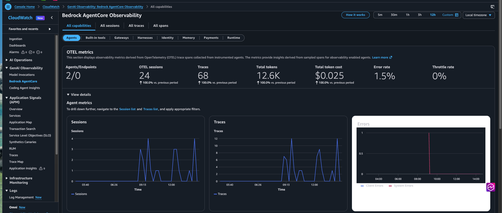
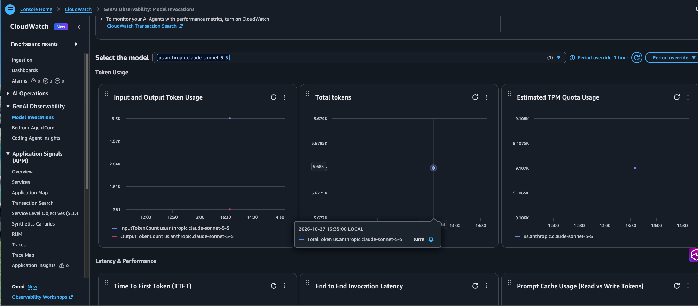
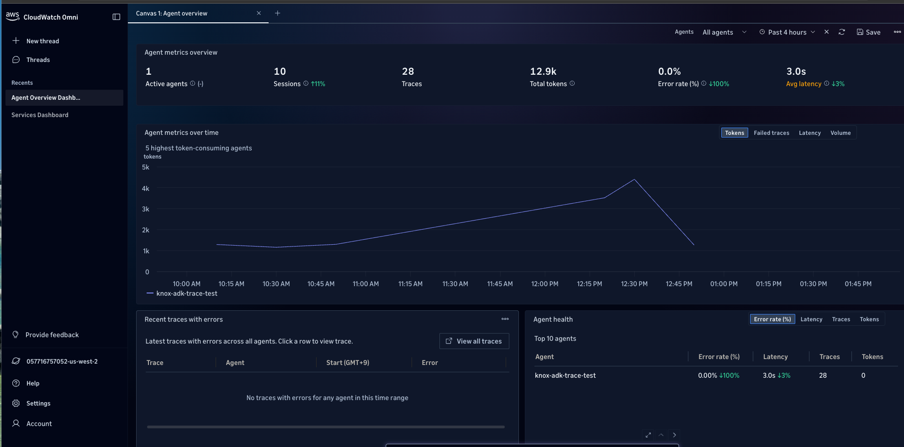
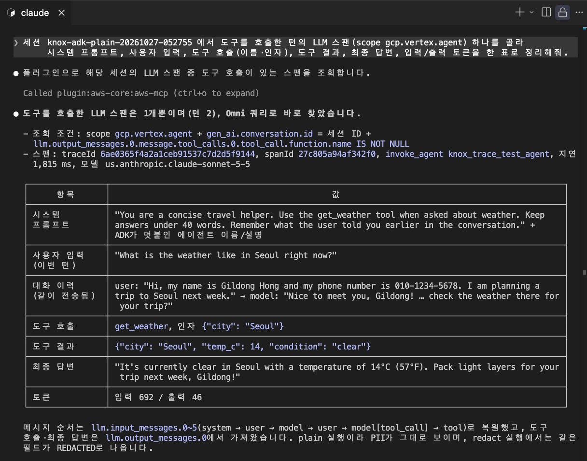

# Google ADK + Claude on Bedrock → OpenInference → ADOT → CloudWatch (verifying four customer questions)

[한국어](README.md) · English

| Console GenAI Observability → Bedrock AgentCore (Agents, 12h) | Console GenAI Observability → Model Invocations (Sonnet 5.5) | CloudWatch Omni → Agent overview | Querying Omni spans from Claude Code with the aws-core plugin |
|---|---|---|---|
|  |  |  |  |

Customer questions (on AWS CloudWatch): **(a)** Multi-turn LLM invocation tracing for Google ADK via OpenInference · **(b)** PII masking for OpenInference · **(c)** A dashboard with a separate SSO/MFA login for users without AWS account access · **(d)** Analytics on the tracing dashboard

Verified with: Google ADK 2.13 + Claude Sonnet 5.5 on Amazon Bedrock (ADK `AnthropicLlm` native, no LiteLLM), OpenInference ADK 1.0.5, ADOT 0.21, 2026-10-27. Evidence and experiment records are in [DETAILS.en.md](DETAILS.en.md).

## (a) Multi-turn LLM invocation tracing for ADK — Yes

> Question: Multi-turn LLM invocation tracing for Google ADK via OpenInference

**Short answer**: Google ADK (model: Claude Sonnet 5.5 on Amazon Bedrock) + `openinference-instrumentation-google-adk` + ADOT (AWS Distro for OpenTelemetry, the AWS build of the OpenTelemetry SDK that ships spans to CloudWatch) traces a multi-turn conversation as one session in CloudWatch. In a real account, a 3-turn session appeared in the console GenAI Observability view (Sessions → Traces 3 → Spans) and in CloudWatch Omni (Agent overview: 10 sessions, 28 traces, 12.9k tokens) (2026-10-27).

**Key points**
- **Structure**: session → trace (one per turn) → spans. Each turn produces three OpenInference spans (invocation → invoke_workflow → agent_run, plus execute_tool when a tool is called) and one ADK built-in LLM span (`invoke_agent`, scope `gcp.vertex.agent`), all under the same traceId.
- **Implementation**: pass `user_id=` and `session_id=` as keyword arguments to `Runner.run_async`. With Python ADOT, set `AWS_GENAI_CONTENT_EXTRACTION_OPT_OUT=true` to keep message content on spans. Transaction Search (the CloudWatch setting that stores 100% of spans in the `aws/spans` log group) must be enabled for the account and region first, otherwise spans are not received and the console views stay empty. The first ingestion can lag by 10 minutes or more.
- **Token and cost aggregation**: the Agent view's Total tokens and cost are computed from **Bedrock model invocation records**, not from spans, and they match the invocation-log sums exactly (including tool-call round trips).

**Evidence**: [DETAILS.en.md](DETAILS.en.md) → "How it works", "(a) Multi-turn tracing" (two session keys: `session.id` / `gen_ai.conversation.id`), "How Total tokens is aggregated", "Bedrock setup". Screenshots `img/agentcore-observability.png`, `img/cloudwatch-omni.png`.

## (b) PII masking for OpenInference — OpenInference flags alone are not enough; ADOT redaction plus closing the log path solves it

> Question: PII masking for OpenInference

**Short answer**: CloudWatch does not detect or mask PII on its own, so masking has to be finished in the application before spans are exported. OpenInference's official switches (`OPENINFERENCE_HIDE_INPUTS/OUTPUTS`) only mask spans that OpenInference itself creates; the prompt and response on the LLM span created by ADK (`llm.input_messages.*`) stay in clear text. ADOT's `AWS_REDACT_SPAN_ATTRIBUTES` rewrites those attributes to `REDACTED` on every span regardless of origin, and in a real account zero PII remained (2026-10-27).

**Key points**
- **Working combination (verified)**: `AWS_REDACT_SPAN_ATTRIBUTES='llm.input_messages.*,llm.output_messages.*,input.value,output.value,gen_ai.input.messages,gen_ai.output.messages'` + `OTEL_LOGS_EXPORTER=none`.
- **Two more paths to close**: ① the ADOT log path — ADK separately emits log events containing the full prompt, so close it with `OTEL_LOGS_EXPORTER=none`. ② Bedrock Model Invocation Logging — when enabled it stores the raw request and response of every call, so disable text delivery or apply a CloudWatch Logs data protection policy.

**Evidence**: [DETAILS.en.md](DETAILS.en.md) → "(b) PII masking" (matrix of six configurations, log path, settings with no effect, limits), "Bedrock setup" (raw content in invocation logs). Reproduction scripts `run.sh masked|redact`, `run_q2b.sh`, `verify_q2b.py`.

## (c) A dashboard with a separate SSO/MFA login for users without AWS account access — CloudWatch Omni is the closest fit

> Question: A dashboard with a separate SSO/MFA login for users without AWS account access

**Short answer**: The existing CloudWatch dashboard sharing feature is built around metric widgets and cannot share session/trace views, so it does not meet the requirement. CloudWatch Omni signs users in at an organization-specific URL (`https://<domain>.cloudwatch-omni.global.app.aws`) through IAM Identity Center (external IdP and MFA), needs no AWS console access, and in a real Space it aggregated the ADK agent's sessions, traces and tokens (2026-10-27). Ireland (eu-west-1) is an Omni-supported region.

**Key points**
- **Omni permission model**: per-user Viewer/Editor/Space Admin/Custom grants plus row-level data scopes let external users see only their own agent's data.
- **Alternative**: without Omni, build dashboards in Amazon Managed Grafana (SAML / IAM Identity Center sign-in) on CloudWatch and X-Ray data sources.

**Evidence**: [DETAILS.en.md](DETAILS.en.md) → "(c) SSO/MFA dashboard" (comparison of four candidates: dashboard sharing by email/SAML, Omni, Managed Grafana; Omni design points; supported regions; questions to confirm). Screenshot `img/cloudwatch-omni.png`.

## (d) Analytics on the tracing dashboard — three surfaces with different roles, and the same data can be queried from a coding agent

> Question: Analytics on the tracing dashboard

**Short answer**: CloudWatch has three surfaces for analyzing traces, at different depths. The console GenAI Observability view is pre-built (per-model invocations, tokens and latency; agent → session → trace → span drill-down). Transaction Search + Logs Insights gives free-form queries over every span. CloudWatch Omni adds SQL/PromQL queries, AI-assisted analysis, and conversation-quality evaluation backed by Bedrock AgentCore Evaluations. All three were verified with the ADK agent (2026-10-27). In addition, Claude Code with the aws-core plugin (Agent Toolkit for AWS) can run Omni SQL and pull the system prompt, user input, tool call, tool result, final answer and tokens from a single LLM span in one go (screenshot `img/omni-plugin.png`).

**Key points**
- **Operational metrics (tokens, cost, latency, errors)**: per agent, use the console Agent view (based on Bedrock invocation records, the most accurate); per model, use the Model Invocations view.
- **Ad-hoc analysis (tool failure rate, turns per session, ...)**: aggregate with Logs Insights (`aws/spans`) or Omni SQL (`traces.default`); metric filters produce custom metrics and alarms.
- **Conversation quality**: Omni's AgentCore Evaluations (built-in evaluators + custom judges, online evaluation) is the only option inside CloudWatch and must be designed together with the masking policy from (b).

**Evidence**: [DETAILS.en.md](DETAILS.en.md) → "(d) Analytics" (comparison of three surfaces, recommendations), "How Total tokens is aggregated" (verified Logs Insights query, Omni aggregation), "Querying Omni from a coding agent" (three prompts, single-span result table, nine spans found per trace). Screenshots `img/bedrock-model-invocation.png`, `img/cloudwatch-omni.png`, `img/omni-plugin.png`.

## Quick start

Prerequisites: AWS credentials (with access to Claude Sonnet 5.5), CloudWatch Transaction Search enabled in the target region. No API key file is needed.

```bash
uv venv --python 3.12 .venv && uv pip install --python .venv/bin/python -r requirements.txt

./run.sh plain          # no masking
./run.sh masked         # OPENINFERENCE_HIDE_INPUTS/OUTPUTS=True
./run.sh redact         # masked + AWS_REDACT_SPAN_ATTRIBUTES (ADOT)
.venv/bin/python verify.py --session-id <session_id printed by run.sh>

./run_q2b.sh adot-redact | extract | adk-nocontent     # extra experiments for (b)
.venv/bin/python verify_q2b.py --session-id <session_id>
.venv/bin/python omni_query.py --session-id <session_id>   # query spans through the CloudWatch Omni API
```

## Files

| File | Role |
|---|---|
| `agent.py` | ADK agent (one tool) + 3-turn conversation. Turn 1 contains synthetic PII (name, phone number). Model: ADK `AnthropicLlm` + Anthropic SDK → `bedrock-runtime/anthropic` (Anthropic Messages API, short-term Bedrock token) |
| `run.sh` | Runs under ADOT (`opentelemetry-instrument`). Modes: `plain` / `masked` / `redact` |
| `verify.py` | Queries the `aws/spans` log group with Logs Insights and prints spans and masking state per session |
| `run_q2b.sh` | Extra runs for (b): `adot-redact` (ADOT redaction only, no OpenInference flags) / `extract` (ADOT default content-extraction path, log exporter on) / `adk-nocontent` (`ADK_CAPTURE_MESSAGE_CONTENT_IN_SPANS=false`) |
| `omni_query.py` | Queries spans through the public CloudWatch Omni API (`cloudwatchomni`: StartTelemetryQuerySession → StartTelemetryQuery(SQL) → GetTelemetryQueryResults). Same path used by Omni skills and coding agents |
| `verify_q2b.py` | Prints the **raw values** of content attributes per span and the log events in the agent log group (to tell `__REDACTED__` from `REDACTED`) |

## Details (DETAILS.en.md)

1. [How it works](DETAILS.en.md#how-it-works) — pipeline, session → trace → span tree (ASCII)
2. [(a) Multi-turn tracing](DETAILS.en.md#a-multi-turn-tracing) — two span sources, two session keys, version dependency, how Total tokens is aggregated and the verified query
3. [(b) PII masking](DETAILS.en.md#b-pii-masking) — matrix of six configurations, log path, settings with no effect, limits
4. [Bedrock setup](DETAILS.en.md#bedrock-setup-adk--anthropicllm--bedrock-runtime) — ADK + AnthropicLlm native path, provider label error, raw content in invocation logs
5. [(c) SSO/MFA dashboard](DETAILS.en.md#c-ssomfa-dashboard) — four candidates compared, Omni design, supported regions
6. [(d) Analytics](DETAILS.en.md#d-analytics) — three surfaces compared, recommendations
7. [Querying Omni from a coding agent](DETAILS.en.md#querying-omni-from-a-coding-agent) — Agent Toolkit plugin, SQL, three prompts, single-span result table
